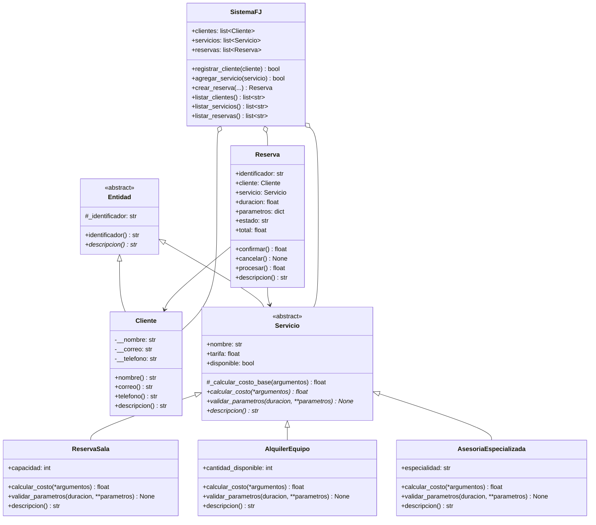

# Software FJ — Sistema Integral de Gestión de Clientes, Servicios y Reservas

Sistema desarrollado en Python bajo el paradigma de **Programación Orientada a Objetos (POO)** para la gestión integral de clientes, servicios especializados y reservas de la empresa **Software FJ**. La aplicación opera completamente en memoria (sin motores de bases de datos) mediante listas y objetos, utilizando manejo avanzado de excepciones y registro continuo de eventos y fallos en archivo de logs.

- **Universidad:** Universidad Nacional Abierta y a Distancia (UNAD)
- **Unidad Gestora:** Escuela de Ciencias Básicas Tecnología e Ingeniería (ECBTI)
- **Programa:** Ingeniería de Sistemas
- **Curso:** Programación — Código `213023` (Fase 4 — Ejercicio 1)

---

## Equipo de Desarrollo

| # | Estudiante | Grupo | Módulo o Responsabilidad |
| :- | :--- | :--- | :--- |
| 1 | Rubén Darío Anaya Polo | 213023_552 | Entidad base, encapsulación de `Cliente` y documentación (`entidad.py`, `cliente.py`, `README.md`) |
| 2 | Carlos Alonso Ruiz Hernández | 213023_552 | Jerarquía de `Servicio`, polimorfismo y excepciones personalizadas (`servicios.py`, `excepciones.py`) |
| 3 | Erik Duway Carpeta Niño | 213023_552 | Ciclo de vida de `Reserva`, controlador `SistemaFJ` y simulación (`reserva.py`, `sistema.py`, `main.py`) |

---

## Estructura del Proyecto

```text
Software-FJ/
├── entidad.py        # Clase abstracta base Entidad con identificador protegido
├── cliente.py        # Clase Cliente con encapsulación (@property) y validaciones estrictas
├── servicios.py      # Clase abstracta Servicio y 3 servicios especializados
├── reserva.py        # Clase Reserva con flujo de estados y encadenamiento de excepciones
├── excepciones.py    # Excepciones personalizadas derivadas de ErrorSistema
├── sistema.py        # Clase SistemaFJ que administra clientes, servicios y reservas en memoria
├── main.py           # Punto de entrada con simulación de operaciones válidas e inválidas
├── software_fj.log   # Archivo generado automáticamente con el historial de eventos y errores
└── README.md         # Documentación técnica y guía de ejecución del proyecto
```

---

## Arquitectura Orientada a Objetos

### Diagrama de Clases (UML)



### Principios Aplicados

1. **Abstracción:** Implementada mediante `ABC` y `@abstractmethod` en `Entidad` (`descripcion`) y `Servicio` (`calcular_costo`, `validar_parametros`, `descripcion`).
2. **Encapsulación:** En `Cliente`, los atributos `__nombre` (mínimo 3 caracteres), `__correo` (validado con expresión regular) y `__telefono` (10 dígitos numéricos) están protegidos y se gestionan mediante `@property` y *setters* con validación.
3. **Herencia y Polimorfismo:** `ReservaSala`, `AlquilerEquipo` y `AsesoriaEspecializada` heredan de `Servicio` e implementan sus propias reglas de validación y descripción:
   - **Reserva de Sala:** Verifica que la cantidad de `asistentes` sea entera, positiva y no supere la `capacidad` de la sala.
   - **Alquiler de Equipos:** Valida que la `cantidad` solicitada sea entera, positiva y menor o igual a `cantidad_disponible`.
   - **Asesoría Especializada:** Exige que la duración esté entre `1` y `8` horas.
4. **Sobrecarga de Métodos:** El método `calcular_costo(*argumentos)` soporta tres formas de invocación:
   - `calcular_costo(duracion)`
   - `calcular_costo(duracion, descuento)`
   - `calcular_costo(duracion, descuento, impuesto)`

---

## Manejo Avanzado de Excepciones y Logs

Todas las excepciones del dominio heredan de la clase base `ErrorSistema` (`excepciones.py`):

| Excepción Personalizada | Cuándo se lanza |
| :--- | :--- |
| `DatosInvalidosError` | Datos de cliente, servicio, tarifas, parámetros o argumentos de costo fuera de regla. |
| `ClienteDuplicadoError` | Intento de registrar un cliente cuyo identificador ya existe en `SistemaFJ`. |
| `ServicioNoDisponibleError` | Intento de reservar o confirmar un servicio no registrado o marcado como no disponible. |
| `ReservaInvalidaError` | Identificador de reserva vacío o fallo encadenado durante `Reserva.procesar()`. |
| `OperacionNoPermitidaError` | Intentar confirmar una reserva que no está `Pendiente` o cancelar una ya `Cancelada`. |

- **Control de flujo completo:** Se utilizan bloques `try / except / else / finally` tanto en `Reserva.procesar()` como en el motor de simulación `ejecutar_operacion()` de `main.py`.
- **Encadenamiento de excepciones:** En `Reserva.procesar()`, cualquier error interno capturado durante `confirmar()` se relanza mediante `raise ReservaInvalidaError(...) from error`, conservando la traza original en el archivo de log.
- **Auditoría en `software_fj.log`:** Configurado con el módulo estándar `logging` (codificación `UTF-8`, nivel `INFO`), registrando tanto las operaciones exitosas como las excepciones completas sin detener la ejecución del programa.

---

## Ejecución del Proyecto

### Requisitos
- **Python 3.10** o superior.
- No requiere instalación de dependencias externas ni motores de base de datos.

### Pasos para ejecutar
1. Clonar o descargar el repositorio y ubicarse en la carpeta raíz del proyecto:
   ```bash
   cd Software-FJ
   ```
2. Ejecutar el archivo principal:
   ```bash
   python main.py
   ```
3. Verificar la salida en consola con las operaciones ejecutadas y revisar el archivo generado `software_fj.log` para auditar eventos y trazas de errores.
